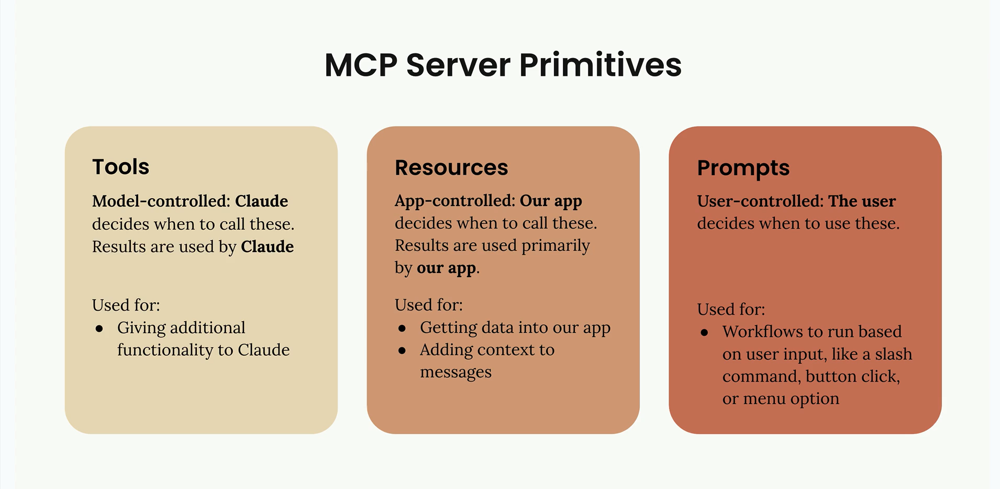
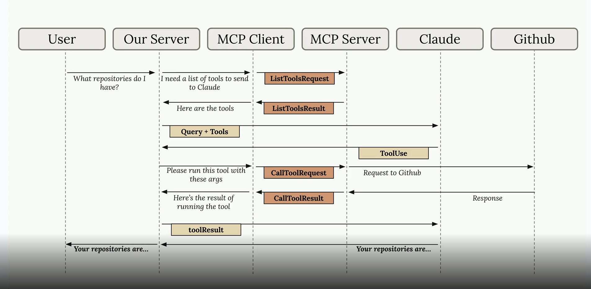

# MCP chat (chapter 7 demo app)

A small command-line chat app that lets you talk to Claude with access to tools, resources, and prompts
served by a local MCP (Model Context Protocol) server.

Chapter 7 of the course is the first one that is not a Jupyter notebook — it is a complete standalone
Python application that composes an MCP client, an MCP server, and a chat loop around the Anthropic SDK.

## What MCP exposes

An MCP server offers three primitives to any MCP-compatible client:



- **Tools**: functions the model can call (model-controlled).
- **Resources**: read-only content the app can pull into the context (app-controlled).
- **Prompts**: pre-defined prompt templates the user picks from (user-controlled).

The demo server (`mcp_server.py`) exposes all three for a small dictionary of fake documents.
See [Server surface](#server-surface) for the full enumeration.

## How a request flows



The diagram shows the six roles that a tool-using chat exchange passes through.
In this demo the "GitHub" lane is replaced by our local document store, but the shape is identical.
Our server (`main.py` + `core/`) talks to the MCP client, which talks to the MCP server, and in parallel talks to
Claude with the aggregated tool list; when Claude emits a `tool_use`, our server routes it through the MCP
client to the MCP server and returns the result to Claude for the final answer.

## File layout

- `main.py` — composes everything: loads env, creates the `Claude` wrapper, the MCP clients, the chat, and the CLI.
- `mcp_server.py` — a local MCP server with tools, resources, and prompts for a fake document store.
- `mcp_client.py` — an MCP client wrapper around `mcp.ClientSession` for a stdio server subprocess.
- `core/claude.py` — thin wrapper around the Anthropic SDK (`class Claude`).
- `core/chat.py` — the base chat loop with Claude + tool execution via the MCP clients.
- `core/cli_chat.py` — subclass of `Chat` adding support for `@doc` resource references and `/command` prompts.
- `core/cli.py` — the interactive terminal UI (prompt-toolkit): history, autocompletion, keybindings.
- `core/tools.py` — `ToolManager` aggregates tools from all MCP clients and routes `tool_use` to the right one.

## Setup

The chapter uses the same `.env` and `pyproject.toml` as the rest of the course — see the top-level README for
`uv sync` and `ANTHROPIC_API_KEY` setup.
No extra variables are required; the chat defaults to `claude-haiku-4-5`.
To override, set `CLAUDE_MODEL=<id>` in `.env`.

## Running the app

The app spawns the MCP server as a subprocess (`uv run mcp_server.py`), so cwd must be the chapter folder:

```
cd 7_model_context_protocol
uv run main.py
```

You get a `> ` prompt. Three ways to interact:

- **Plain chat**: type a question and press Enter.
- **Document reference** (`@docid`): mention a document id to pull its contents into the prompt.
  ```
  > What topics does @deposition.md cover?
  ```
  Tab-completion suggests the available ids.
- **Prompt command** (`/name docid`): invoke one of the MCP prompts.
  ```
  > /summarize deposition.md
  > /format plan.md
  ```
  Tab-completion suggests command names and document ids.

Exit with Ctrl+C.

## Inspecting the MCP server standalone

The `mcp` CLI (installed via `mcp[cli]`) ships an inspector you can use to poke at the server without the chat app:

```
cd 7_model_context_protocol
uv run mcp dev mcp_server.py
```

Opens a local web UI (URL printed in the terminal). Click **Connect**, then **Tools / List Tools** to see
`list_docs`, `read_doc_contents` and `edit_document`, pick one, fill in the arguments, and click **Run Tool** to see the
raw JSON response. The **Resources** and **Prompts** tabs work the same way. Useful when debugging a new MCP
server before hooking it to Claude.

## Server surface

What `mcp_server.py` exposes to any connected MCP client:

### Tools

| Name | Args | Description |
|---|---|---|
| `list_docs` | — | List the ids of all available documents. |
| `read_doc_contents` | `doc_id` | Read the contents of a document and return it as a string. |
| `edit_document` | `doc_id`, `old_str`, `new_str` | Replace `old_str` with `new_str` in the document's content (mutates in memory). |

### Resources

| URI pattern | MIME | Description |
|---|---|---|
| `docs://documents` | `application/json` | List of all document ids. |
| `docs://documents/{doc_id}` | `text/plain` | Contents of a single document. |

### Prompts

| CLI command | Args | What it asks Claude to do | Tools it ends up triggering |
|---|---|---|---|
| `/format <doc_id>` | `doc_id` | Rewrite the document as Markdown and persist the change. | `read_doc_contents`, `edit_document` |
| `/summarize <doc_id>` | `doc_id` | Read the document and write a short summary. | `read_doc_contents` |

## Request flow examples

Three concrete walkthroughs that cover the three CLI interaction styles.

### `@deposition.md who is this about?` (resource reference)

1. CLI (`core/cli_chat.py:_extract_resources`) scans the query, finds `@deposition.md`.
2. CLI → MCP server: `read_resource("docs://documents/deposition.md")` via `mcp_client.read_resource`.
3. Server → CLI: resource contents (`"This deposition covers the testimony of Angela Smith, P.E."`).
4. CLI wraps the query in a prompt that embeds the content inline inside `<context>...</context>`.
5. CLI → Claude: a single `messages.create` call with the wrapped prompt.
6. Claude answers directly, no `tool_use` emitted — the wrapper tells it the content is already present.

Pedagogical point: `@` is **app-controlled**. The resource is pulled in by our code before Claude ever runs. Zero round-trips with the server during Claude's turn.

### `/summarize report.pdf` (prompt + single tool)

1. CLI (`core/cli_chat.py:_process_command`) detects the leading `/`, splits into `("summarize", "report.pdf")`.
2. CLI → MCP server: `get_prompt("summarize", {"doc_id": "report.pdf"})` via `mcp_client.get_prompt`.
3. Server runs `summarize_document(doc_id="report.pdf")` and returns the expanded `UserMessage`: *"Your goal is to summarize... use the `read_doc_contents` tool to read the document... Respond with the summary text only."*
4. CLI appends that message to the history and starts the chat loop (`core/chat.py:run`).
5. CLI → Claude: `messages.create` with the expanded prompt plus the aggregated tool list (`list_docs`, `read_doc_contents`, `edit_document`).
6. Claude emits a `tool_use` for `read_doc_contents(doc_id="report.pdf")`.
7. `core/tools.py:ToolManager.execute_tool_requests` finds the right client, calls `client.call_tool`, gets the content back.
8. CLI appends the `tool_result` as a user message, loops back to step 5.
9. Claude returns a text summary; `stop_reason != "tool_use"` breaks the loop.

Pedagogical point: `/` is **user-controlled**. The prompt text drives Claude toward a specific tool call (`read_doc_contents`). The server never runs the tool itself — it just hands Claude a prompt that nudges it.

### `/format plan.md` (prompt + multi-tool loop)

1-4. Same as `/summarize`, but the expanded prompt instructs Claude to use `edit_document` after reading.
5. CLI → Claude.
6. Claude emits `tool_use` for `read_doc_contents(doc_id="plan.md")`.
7. CLI runs it, feeds the content back.
8. Claude decides on the Markdown rewrite, emits `tool_use` for `edit_document(doc_id="plan.md", old_str=..., new_str=...)`.
9. CLI runs it; `mcp_server.py:edit_document` mutates the in-memory `docs` dict.
10. Claude emits a final text message with the rewritten doc; loop exits.

Pedagogical point: a single prompt can drive **a chain** of tool calls. The loop in `core/chat.py:run` keeps calling Claude until `stop_reason != "tool_use"`, so you get as many turns as the task needs.
