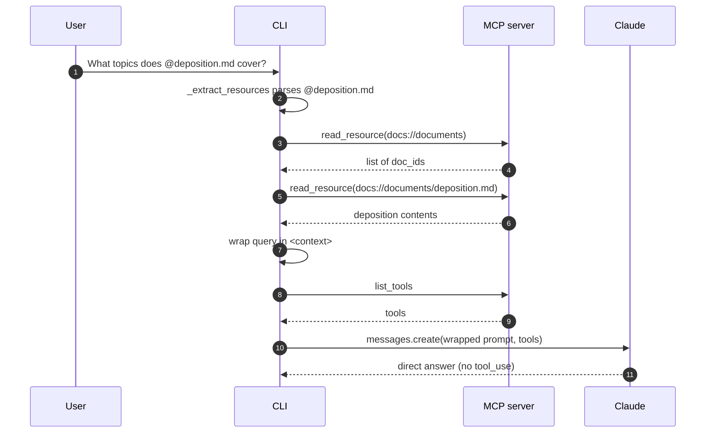
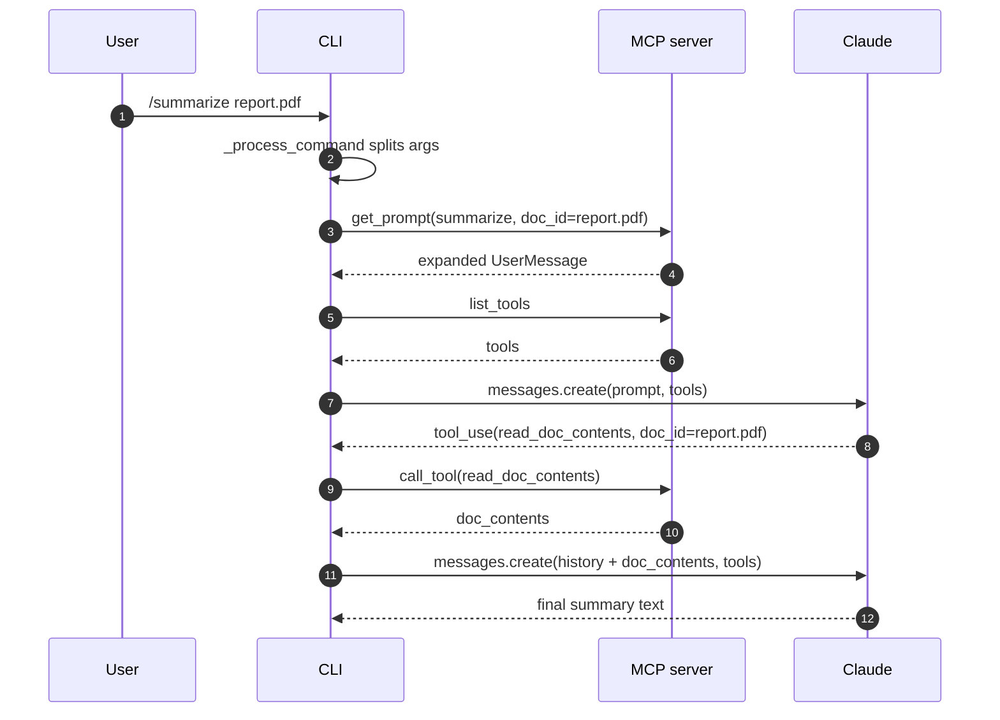
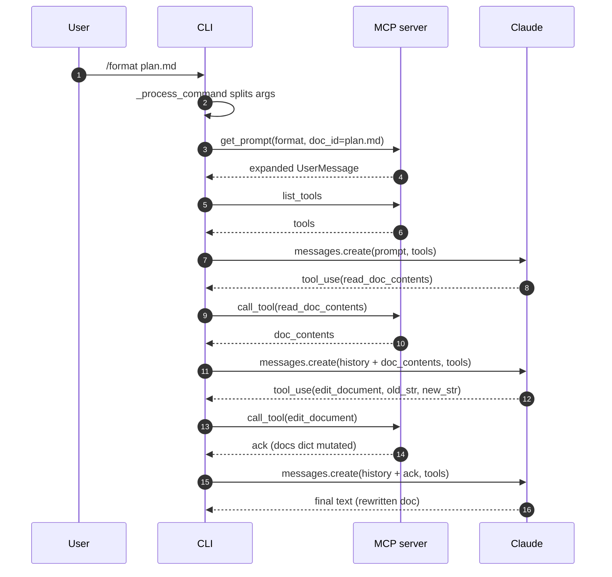

# MCP chat (chapter 7 demo app)

A small command-line chat app that lets you talk to Claude with access to tools, resources, and prompts
served by a local MCP (Model Context Protocol) server.

Chapter 7 of the course is the first one that is not a Jupyter notebook — it is a complete standalone
Python application that composes an MCP client, an MCP server, and a chat loop around the Anthropic SDK.

## What MCP exposes

An MCP server offers three primitives to any MCP-compatible client:


- **Tools**: functions the model can call (model-controlled).
- **Resources**: read-only content the app can pull into the context (app-controlled).
- **Prompts**: pre-defined prompt templates the user picks from (user-controlled).

The demo server (`mcp_server.py`) exposes all three for a small dictionary of fake documents.
See [Server surface](#server-surface) for the full enumeration.

## How a request flows


The diagram shows the six roles that a tool-using chat exchange passes through.
In this demo the "GitHub" lane is replaced by our local document store, but the shape is identical.
Our server (`main.py` + `core/`) talks to the MCP client, which talks to the MCP server, and in parallel talks to
Claude with the aggregated tool list; when Claude emits a `tool_use`, our server routes it through the MCP
client to the MCP server and returns the result to Claude for the final answer.

## File layout

- `main.py` — composes everything: loads env, creates the `Claude` wrapper, the MCP clients, the chat, and the CLI.
- `mcp_server.py` — a local MCP server with tools, resources, and prompts for a fake document store.
- `mcp_client.py` — an MCP client wrapper around `mcp.ClientSession` for a stdio server subprocess.
- `core/claude.py` — thin wrapper around the Anthropic SDK (`class Claude`).
- `core/chat.py` — the base chat loop with Claude + tool execution via the MCP clients.
- `core/cli_chat.py` — subclass of `Chat` adding support for `@doc` resource references and `/command` prompts.
- `core/cli.py` — the interactive terminal UI (prompt-toolkit): history, autocompletion, keybindings.
- `core/tools.py` — `ToolManager` aggregates tools from all MCP clients and routes `tool_use` to the right one.

## Setup

The chapter uses the same `.env` and `pyproject.toml` as the rest of the course — see the top-level README for
`uv sync` and `ANTHROPIC_API_KEY` setup.
No extra variables are required; the chat defaults to `claude-haiku-4-5`.
To override, set `CLAUDE_MODEL=<id>` in `.env`.

## Running the app

The app spawns the MCP server as a subprocess (`uv run mcp_server.py`), so cwd must be the chapter folder:

```
cd 7_model_context_protocol
uv run main.py
```

You get a `> ` prompt. Three ways to interact:

- **Plain chat**: type a question and press Enter.
- **Document reference** (`@docid`): mention a document id to pull its contents into the prompt.
  ```
  > What topics does @deposition.md cover?
  ```
  Tab-completion suggests the available ids.
- **Prompt command** (`/name docid`): invoke one of the MCP prompts.
  ```
  > /summarize report.pdf
  > /format plan.md
  ```
  Tab-completion suggests command names and document ids.

Exit with Ctrl+C.

## Inspecting the MCP server standalone

The `mcp` CLI (installed via `mcp[cli]`) ships an inspector you can use to poke at the server without the chat app:

```
cd 7_model_context_protocol
uv run mcp dev mcp_server.py
```

You should see something like:

```
Starting MCP inspector...
⚙️ Proxy server listening on port 6277
🔍 MCP Inspector is up and running at http://127.0.0.1:6274 🚀
```

Then:

- Open the URL printed in the terminal in a browser to show the local web UI.
- Click **Connect**.
- Click **Tools / List Tools** to see `list_docs`, `read_doc_contents` and `edit_document`.
- Pick a tool, fill in the arguments, and click **Run Tool** to see the raw JSON response.
- The **Resources** and **Prompts** tabs work the same way.

Useful when debugging a new MCP server before hooking it to Claude.

## Server surface

What `mcp_server.py` exposes to any connected MCP client:

### Tools

| Name | Args | Description |
|---|---|---|
| `list_docs` | — | List the ids of all available documents. |
| `read_doc_contents` | `doc_id` | Read the contents of a document and return it as a string. |
| `edit_document` | `doc_id`, `old_str`, `new_str` | Replace `old_str` with `new_str` in the document's content (mutates in memory). |

### Resources

| URI pattern | MIME | Description |
|---|---|---|
| `docs://documents` | `application/json` | List of all document ids. |
| `docs://documents/{doc_id}` | `text/plain` | Contents of a single document. |

### Prompts

| CLI command | Args | What it asks Claude to do | Tools it ends up triggering |
|---|---|---|---|
| `/format <doc_id>` | `doc_id` | Rewrite the document as Markdown and persist the change. | `read_doc_contents`, `edit_document` |
| `/summarize <doc_id>` | `doc_id` | Read the document and write a short summary. | `read_doc_contents` |

## Request flow examples

Three concrete walkthroughs that cover the three CLI interaction styles.

### `What topics does @deposition.md cover?` (resource reference)



Walkthrough of the key moments:

- **Steps 1-7 (resource extraction)**: `_extract_resources` parses the `@`-mention, asks the server for the full list of doc ids, fetches the contents of the matched doc, and wraps them inside `<context>...</context>` in the prompt.
- **Steps 8-9 (tool list)**: `ToolManager.get_all_tools` calls `list_tools` on every client before each `messages.create` (no cache — happens on every chat-loop iteration).
- **Steps 10-11 (single turn with Claude)**: Claude answers directly; the wrapper tells it the content is already present, so no `tool_use` is emitted.

Pedagogical point: `@` is **app-controlled**. The resource is pulled in by our code before Claude ever runs. Zero round-trips with the server during Claude's turn.

### `/summarize report.pdf` (prompt + single tool)



Walkthrough of the key moments:

- **Steps 1-4 (prompt expansion)**: user issues `/summarize`, CLI asks the server for the expanded `UserMessage` and appends it to the history.
- **Steps 5-8 (first turn with Claude)**: CLI fetches `list_tools`, sends prompt + tools, Claude emits `tool_use` for `read_doc_contents`.
- **Steps 9-10 (tool execution)**: CLI calls `read_doc_contents` and gets back the document.
- **Steps 11-12 (second turn, final answer)**: CLI sends the updated history, Claude returns the summary and the loop exits (`stop_reason != "tool_use"`).

Pedagogical point: `/` is **user-controlled**. The prompt text drives Claude toward a specific tool call (`read_doc_contents`). The server never runs the tool itself — it just hands Claude a prompt that nudges it.

### `/format plan.md` (prompt + multi-tool loop)



Walkthrough of the key moments:

- **Steps 1-4 (prompt expansion)**: same shape as `/summarize` — CLI asks the server for the expanded `UserMessage` and appends it.
- **Steps 5-8 (first turn)**: CLI fetches `list_tools`, sends prompt + tools, Claude emits `tool_use` for `read_doc_contents`.
- **Steps 9-10 (read tool)**: CLI calls `read_doc_contents` and gets back the document.
- **Steps 11-12 (second turn)**: CLI sends the updated history, Claude emits `tool_use` for `edit_document`.
- **Steps 13-14 (edit tool)**: CLI calls `edit_document`; `mcp_server.py:edit_document` mutates the in-memory `docs` dict.
- **Steps 15-16 (final turn)**: CLI sends the updated history, Claude returns the rewritten doc and the loop exits.

Pedagogical point: a single prompt can drive **a chain** of tool calls. The loop in `core/chat.py:run` keeps calling Claude until `stop_reason != "tool_use"`, so you get as many turns as the task needs.
